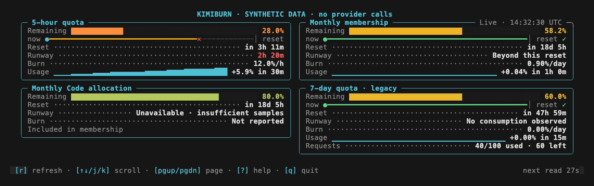

# Kimiburn

**A read-only terminal monitor for Kimi Code membership quotas and runway.**

Website: <https://acevedomiguel.github.io/kimiburn/>

<p align="center">
  
</p>

Captured from `kimiburn demo` with synthetic values; the dashboard shows only your own account figures. Regenerate it with `vhs assets-src/terminal-demo.tape` after `make build`.

Kimiburn shows the shared monthly membership, the Monthly Code allocation when
reported, the rolling 5-hour quota, and a legacy 7-day quota when the API
reports one. It also derives local burn-rate and runway estimates from
repeated observations.

Built with Go and Charm as a sibling of
[Routeburn](https://github.com/acevedomiguel/routeburn).

> Kimiburn only reads data. It sends no inference traffic, changes no quota,
> never rotates or revokes tokens, and never falls back to Moonshot Open
> Platform. Ratio-only responses cannot reveal absolute request, token, or
> currency amounts. The monthly Code allocation is part of the shared
> membership quota; the two are never added together.

## What it does

- Reads only `GET /usages` beneath the selected Kimi Code API base.
- Refreshes every 30 seconds by default, measured from request completion. The
  interval is adjustable from the in-app Settings overlay (10s, 30s, 1m, 5m, 10m)
  and saved to the configuration file.
- Preserves unknown provider fields in local `--json` output.
- Keeps a private, versioned cache for offline display and local samples.
- Labels cached data, parser conflicts, missing values, and unavailable
  estimates instead of inventing plausible numbers.
- Includes a deterministic synthetic demo that needs no token or network.
- Built on [Charm](https://charm.land) v2: `help` and `key` bubbles drive the
  footer, the Help overlay and the Settings overlay, a `spinner` marks
  refreshes, `progress` draws the meters, `viewport` scrolls the body and Help,
  and the lipgloss compositor lays Help and Settings over the dashboard.

## Installation

### Homebrew (macOS and Linux)

```bash
brew tap acevedomiguel/kimiburn
brew install --cask kimiburn
kimiburn --version
```

Upgrades arrive through the same tap:

```bash
brew update
brew upgrade --cask kimiburn
```

The cask downloads a prebuilt binary rather than compiling from source. That
binary is not notarized by Apple, so the cask clears the macOS quarantine flag
after staging; without that step Gatekeeper would kill the binary on first run.
The tap is a third-party tap, so Homebrew asks you to trust it once:

```bash
brew trust --tap acevedomiguel/kimiburn
```

### Go

```bash
go install github.com/acevedomiguel/kimiburn/cmd/kimiburn@latest
```

### Prebuilt binaries

Every release publishes Linux, macOS, and Windows archives plus a
`checksums.txt` file on the GitHub Releases page. Archives contain the binary,
this README, and the LICENSE; Linux and macOS use `.tar.gz`, Windows uses
`.zip`. Targets are Linux/macOS/Windows amd64 and Linux/macOS arm64. Verify a
download with:

```bash
sha256sum -c checksums.txt --ignore-missing
```

### From source

Use Go 1.26.0 or newer:

```bash
git clone https://github.com/acevedomiguel/kimiburn.git
cd kimiburn
make build
./kimiburn --version
```

## Set up a token

Supply a Kimi Code token explicitly. Kimiburn never imports credentials from
Pi, the Kimi CLI, or another application.

```sh
kimiburn setup
```

Running `kimiburn` without a token starts this setup automatically, then opens
the dashboard after success; a second command is not needed. Setup accepts a
hidden terminal entry or one piped token, validates it with one live usage
request, and then stores it. The OS keyring is preferred. If the
keyring is unavailable, a permission-restricted fallback file is used. For a
non-interactive process, set `KIMIBURN_TOKEN` in its environment.

Replace the token later without leaving the dashboard: press `s` to open
Settings, choose **Update token**, and type or paste the new token. It is hidden
as you enter it, checked with one usage read, and saved only after that read
succeeds; the previous token stays in place otherwise. When `KIMIBURN_TOKEN` is
set it wins, so the overlay explains that it must be unset before a token can be
stored here.

```sh
printf '%s\n' "$KIMIBURN_TOKEN" | kimiburn setup
```

Do not paste tokens into shell history, issues, logs, or commits. `logout`
removes only Kimiburn's local token and keyring entry; it does not revoke the
token with Kimi:

```sh
kimiburn logout
```

## Use

```sh
kimiburn                    # live alternate-screen dashboard
kimiburn demo --no-color    # synthetic dashboard; no credentials or network
kimiburn --json             # one live schema-1 JSON document on stdout
kimiburn --json --no-cache  # no cache reads or writes
kimiburn --refresh 45s      # override the polling interval
kimiburn --refresh 0        # manual refresh only
kimiburn --help
kimiburn --version
```

Dashboard keys: `r` refreshes, `s` opens Settings (refresh interval and token),
arrow keys, `j`/`k`, or the mouse wheel scroll, Page Up/Page Down scroll a page,
Home/End jump, `?` opens help, and `q` or Esc quits. In Help, Esc, `?`, or `q`
close the overlay and return to the dashboard; only Ctrl+C quits from there. In
Settings, Esc, `q`, or `s` closes it, `↑`/`↓` (or `j`/`k`) pick a row, `←`/`→`
(or `h`/`l`) or a number key 1–5 chooses the interval, and Enter starts a token
entry. While typing a token the letters are token content, so only Enter saves,
Esc cancels, and Ctrl+C quits. A manual refresh is
throttled to one attempt per 30 seconds. A 401/403 suspends automatic requests
until a manual refresh succeeds. Refresh intervals below 10 seconds are
rejected unless the value is zero. Demo mode uses the same 30-second scheduler
but refreshes only synthetic data and never contacts the provider, so its
interval change is session-only and its token row is disabled.

### Panels and runway

The monthly membership and 5-hour panels have priority. Monthly Code allocation
(`limit_month_code`) appears only when reported; it is included in the monthly
membership, not an additional allowance. Legacy 7-day data also appears only
when reported. Each panel shows:

- **Remaining**: a meter coloured from green through amber to red as the quota
  drains, animating to each new reading, beside the remaining percentage.
- **Timeline**: `now ●━━━━✕┄┄│ reset`, the estimated depletion (✕) against the
  reset on one axis; `reset ✓` means the quota lasts past the reset.
- **Reset**, **Runway**, and **Burn**, with countdowns updated every second.
- **Usage**: a sparkline of the locally retained readings of the current reset
  period, with how much was used over that span.

The footer counts down to the next automatic read, or shows a spinner while a
read is in flight. The terminal tab title carries the 5-hour quota and runway;
in Ghostty, WezTerm, and Windows Terminal the 5-hour quota also appears as the
terminal's own progress indicator. Colours follow the terminal's light or dark
background unless `theme` pins one. The dashboard keeps raw provider JSON out
of the way; use `--json` when you need the complete structured response.

Runway and burn are calculated locally, not supplied by Kimi. On a first read,
Kimiburn estimates average burn from the reported ratio and elapsed portion of
the current fixed 5-hour or 7-day window. Monthly estimates assume the reset
repeats on the same monthly date, clamped to the previous month's last day.
After at least five local samples spanning 120 seconds, ordinary least squares
uses the observed sample trend instead. JSON reports the estimator as
`window_average` or `local_samples` in each runway's `basis` field.

A reset or ratio decrease clears only the affected quota's history. Forecasts
never cross reset: `Beyond this reset` has no exhaustion timestamp. Missing
resets, invalid ratios, and conflicting sources produce explicit unavailable
reasons.

## Built on Burn Blocks

KimiBurn is the terminal UI. The read-only Kimi Code usage engine it runs on —
the bounded `GET /usages` client, quota normalization, runway estimation, cache,
configuration, and credential resolution — lives in
[Burn Blocks](https://github.com/acevedomiguel/burnblocks) as the
`github.com/acevedomiguel/burnblocks/kimi` package.

KimiBurn imports that package and adds the Bubble Tea dashboard, the `--json`
output, and the `setup`/`logout` commands. The provider contract and the runway
mathematics are documented in [Burn Blocks](https://github.com/acevedomiguel/burnblocks).
This repository no longer publishes a public Go library of its own; its module
path follows the binary's `v1.x.y` releases.

## Configuration

```sh
kimiburn config path
kimiburn config reset
```

See [`config.example.yaml`](config.example.yaml). Precedence is command-line
flags, `KIMIBURN_*` environment variables, strict YAML, then defaults. Unknown
YAML keys, extra YAML documents, arbitrary API hosts, and token-looking config
keys are rejected.

Defaults:

```yaml
version: 1
refresh_interval: 30s
base_url: https://api.kimi.com/coding/v1
theme: auto
color: auto
keyring: true
```

The only other accepted base is `https://api.kimi.ai/coding/v1`, selected
explicitly for an overseas account. There is no automatic regional fallback.

The in-app Settings overlay writes only `refresh_interval` back to the active
configuration file and preserves every other key; the file stays `0600`. If
`--refresh` or `KIMIBURN_REFRESH_INTERVAL` is set, that override still wins on
the next start, and the overlay says so. A non-interactive process can always
edit the YAML directly.

Environment variables: `KIMIBURN_TOKEN`, `KIMIBURN_REFRESH_INTERVAL`,
`KIMIBURN_BASE_URL`, `KIMIBURN_THEME`, `KIMIBURN_COLOR`, and
`KIMIBURN_KEYRING`. Global flags include `--config`, `--json`, `--refresh`,
`--no-cache`, and `--no-color`.

## JSON, cache, and privacy

`--json` writes exactly one schema-1 document to stdout. It includes normalized
quota entries, nullable local runway values, warnings, freshness metadata, and
the raw provider object. A failed fetch with a valid cache emits cached JSON
with a warning and exit 0. A failed fetch without cache emits no JSON and exits
1. Missing credentials exit 3; usage errors exit 2.

The cache and raw JSON can contain account-specific API data. They are local
private outputs, not safe fixtures or public logs. Review them before sharing.
Tokens are not written to cache or JSON. Errors and warnings redact configured
credentials.

Typical paths (platform defaults and absolute XDG overrides apply):

- Config: `${XDG_CONFIG_HOME:-~/.config}/kimiburn/config.yaml`
- Fallback token: `${XDG_CONFIG_HOME:-~/.config}/kimiburn/token`
- Cache/samples: `${XDG_CACHE_HOME:-~/.cache}/kimiburn/state.json`

On platforms where POSIX permissions are enforced, private directories are
`0700` and token/cache files are `0600`. Windows uses the inherited user-profile
ACL rather than POSIX permission bits.

To uninstall, remove the downloaded binary (or run `brew uninstall --cask
kimiburn` for a Homebrew install), run `kimiburn logout`, and delete
the config and cache directories shown above. No OAuth flow, hosted
service, or Open Platform integration is provided; the project website is
static and never sees a token.

## API stability and limitations

The endpoint and response variants are based on official Kimi client behavior,
not a public stability guarantee. See [`docs/api-contract.md`](docs/api-contract.md)
for mappings and evidence. Exact account behavior remains subject to an opt-in
redacted live probe; no real account response is committed.

## Development

```sh
make check
# equivalent minimum gate:
test -z "$(gofmt -l .)"
go vet ./...
go test -race ./...
go build ./cmd/kimiburn
```

Tests are synthetic-only and require no token, network, keyring, or real user
state. The rendering at the top of this file is an illustration with synthetic
values, not a recorded account; `kimiburn demo` reproduces it without a token
or network. See [`CONTRIBUTING.md`](CONTRIBUTING.md) and
[`SECURITY.md`](SECURITY.md). Licensed under MIT.
